<div align="center">

# 🧱 Stud UI Clean Roblox

### The AI agent skill that builds Roblox UI like a top-chart simulator

Chunky 3D stud buttons · glass streaks · extruded Heavy text · dark glass windows · spinning sunbursts · rarity ladder · bouncy motion

[](SKILL.md)
[](https://create.roblox.com)
[](src/StudUI.luau)
[](references/icon-catalog.md)
[](LICENSE)

[**Download the skill**](../../releases/latest) · [Quick start](#-quick-start) · [Gallery](#-gallery) · [Kit API](#-kit-api) · [🇫🇷 Français](#-en-français)

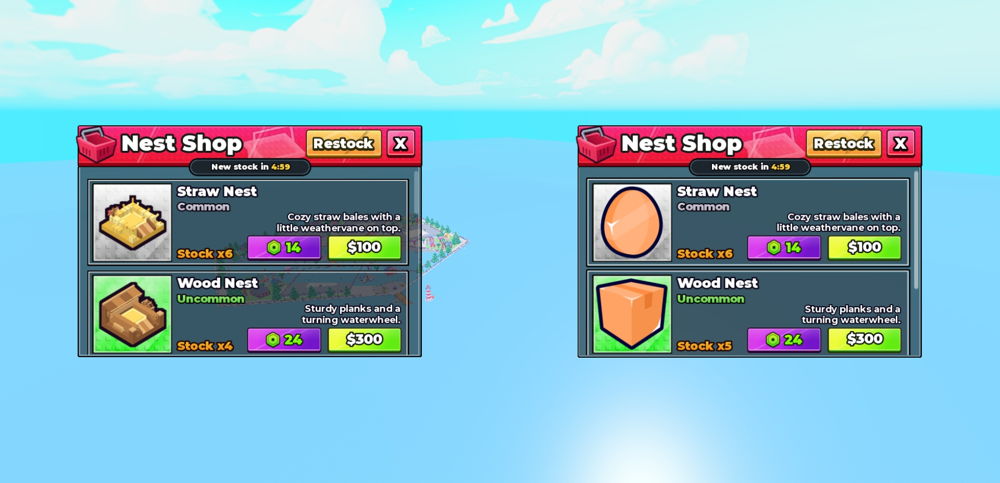

<sub><b>Left:</b> the original shop from a shipped Roblox simulator. <b>Right:</b> the same window generated from scratch by this kit.</sub>

</div>

---

## ✨ What is this?

**Stud UI Clean Roblox** is a ready-to-use [Agent Skill](https://docs.claude.com/en/docs/agents-and-tools/agent-skills/overview):
a folder an AI agent (Claude Code, Claude.ai, or any agent that can read files) loads to create Roblox interfaces in
one precise, polished style. The style was **measured** on a real Roblox experience (17 ScreenGuis, ~7,700 UI instances,
every color, stroke, gradient keypoint and tween timing) and then **rebuilt as a tested Luau component kit**.

Ask your agent *"make me a pet index with rarity tabs"* or *"add a daily rewards menu"* and it builds UI that looks like
it shipped with the game, instead of a generic flat menu.

| The agent gets | So it can |
|---|---|
| 🧩 **`StudUI.luau`** component kit | build 3D buttons, windows, product cards, slots, panels, bars, badges in one call each |
| 🎬 **`StudMotion.luau`** | wire hover / press, bouncy open & close with blur and FOV, idle animations, feedback, sounds |
| 🖼️ **1022 icons** (`CheckUIIcons`) + catalog | pick real `rbxassetid`s instead of placeholders |
| 🎨 **Design tokens** | use the exact palette, fonts, outlines, rarity colors, surfaces |
| 📐 **Layouts & 7 screen archetypes** | compose HUDs, shops, calendars, season passes, collections, reward popups |
| 📸 **14 screenshots** | see the target and compare its own output |
| ✅ **QA checklist** | catch the mistakes that make a UI look "generic" |

## 🖼️ Gallery

<table>
<tr>
<td width="50%">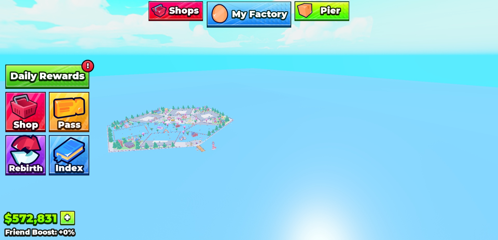<br><sub><b>HUD</b> — nav bar with a bigger primary button, menu tiles with overflowing icons, "!" badge, money counter</sub></td>
<td width="50%">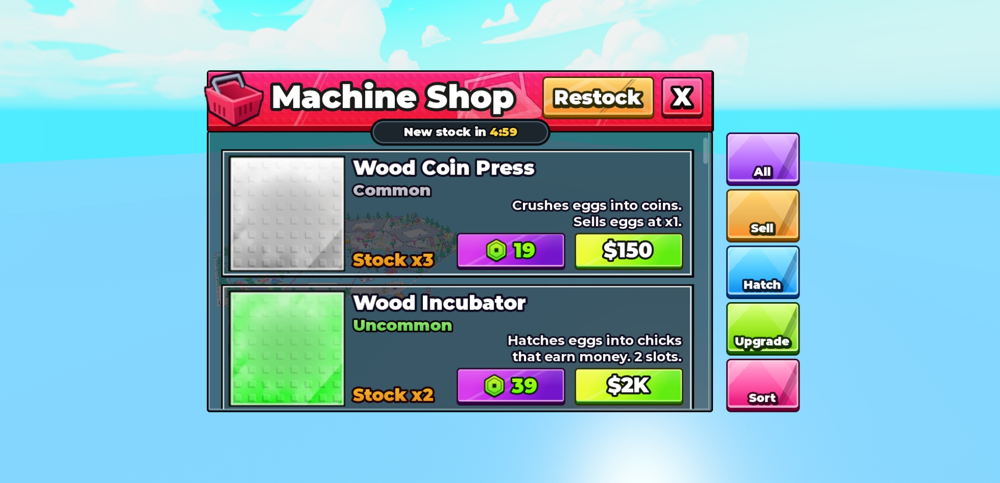<br><sub><b>Shop</b> — stud header, Restock, timer pill on the seam, product cards, category tabs</sub></td>
</tr>
<tr>
<td>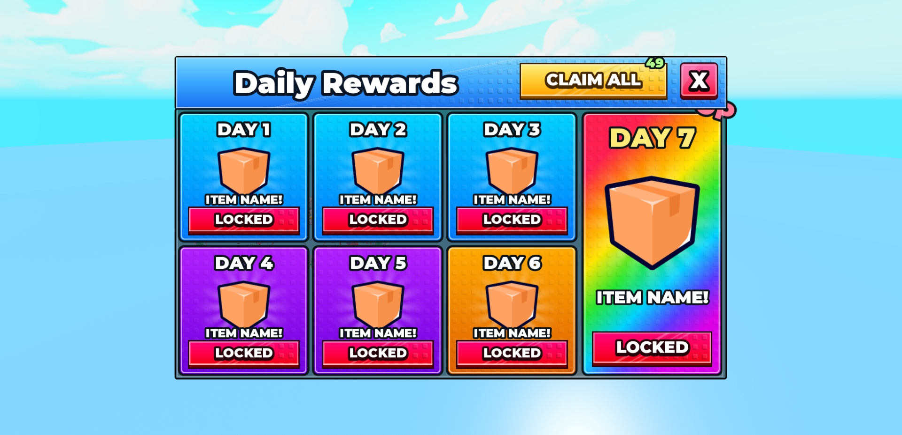<br><sub><b>Daily Rewards</b> — stud tiles, spinning sunbursts, rainbow hero tile, state buttons</sub></td>
<td>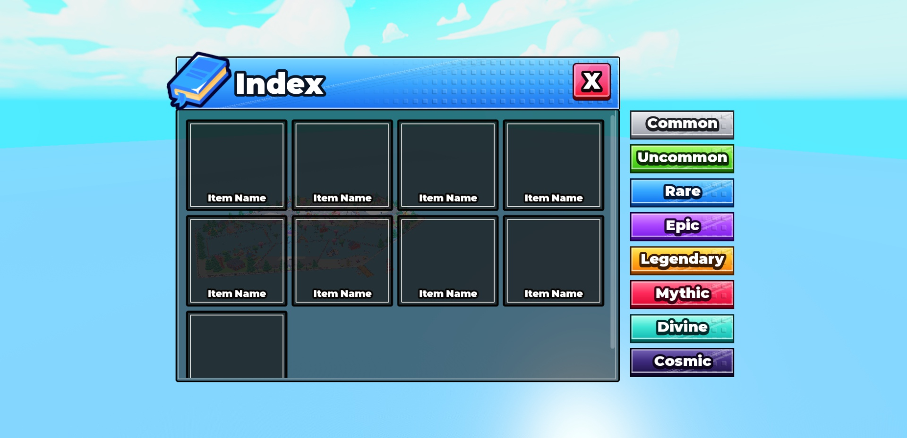<br><sub><b>Index</b> — dark item slots and a Common → Cosmic rarity tab column</sub></td>
</tr>
<tr>
<td>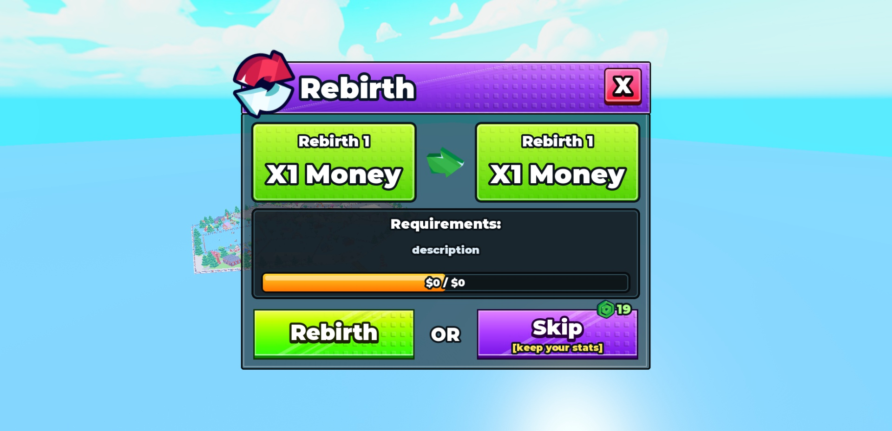<br><sub><b>Rebirth</b> — current → next panels, requirements box, progress bar, Rebirth / OR / Skip</sub></td>
<td>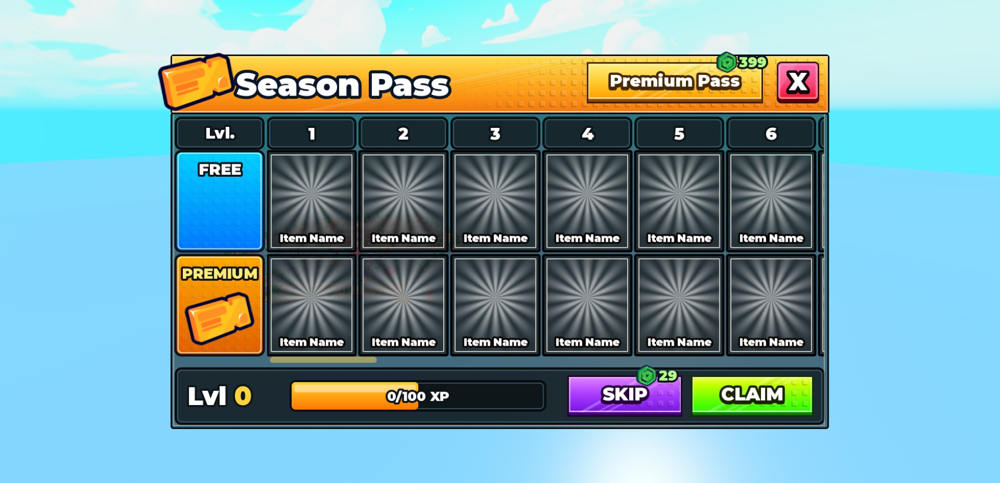<br><sub><b>Season Pass</b> — free / premium tracks, horizontal level columns, XP bar</sub></td>
</tr>
<tr>
<td>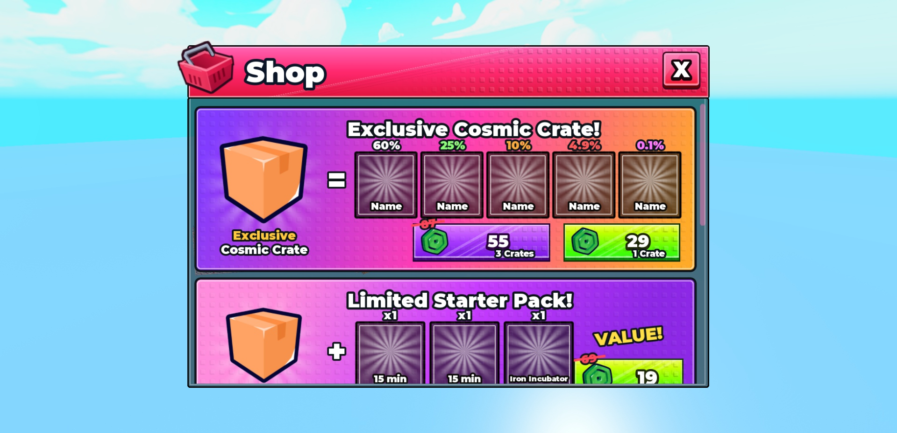<br><sub><b>Robux Shop</b> — gradient offer banners, drop chances, struck-through prices, "VALUE!" stickers</sub></td>
<td>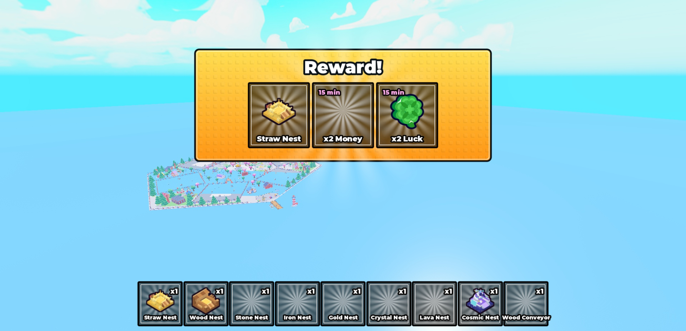<br><sub><b>Reward popup & hotbar</b> — gold banner, reward cards, 80×80 slots</sub></td>
</tr>
<tr>
<td>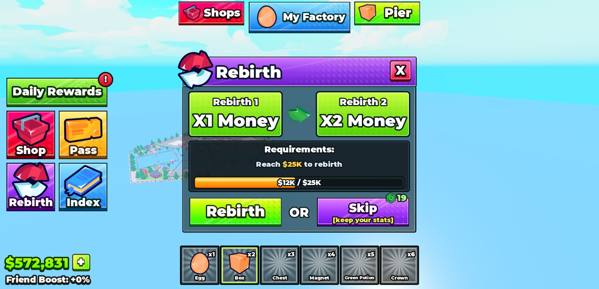<br><sub>✅ <b>Generated by the kit</b> — full HUD + Rebirth window (examples 02 + 03)</sub></td>
<td>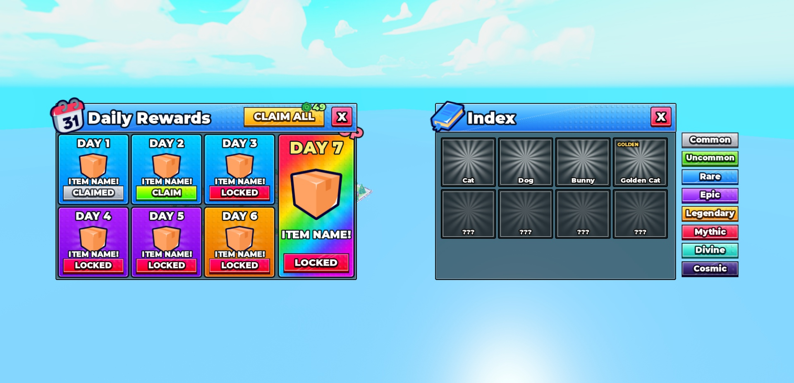<br><sub>✅ <b>Generated by the kit</b> — Daily Rewards + Index with rarity tabs (examples 04 + 05)</sub></td>
</tr>
</table>

More captures and notes: [`assets/screenshots/`](assets/screenshots/README.md).

## 🚀 Quick start

### 1. Install the skill

<details open>
<summary><b>Claude Code</b></summary>

```bash
git clone https://github.com/TemporaryLooker22/Stud-UI-Clean-Roblox ~/.claude/skills/stud-ui-clean-roblox
```
Or put it in a project at `.claude/skills/stud-ui-clean-roblox`. Claude picks it up automatically when you ask for Roblox UI.
</details>

<details>
<summary><b>Claude.ai / Claude Desktop</b></summary>

Download `stud-ui-clean-roblox.skill` from the [latest release](../../releases/latest) and add it in
**Settings → Capabilities → Skills** (or ask Claude to install it).
</details>

<details>
<summary><b>Any other agent</b></summary>

Give the agent this folder and tell it to start with [`SKILL.md`](SKILL.md). Every other file is referenced from there.
</details>

### 2. Ask for UI

Works best when the agent can drive Roblox Studio (for example through the **Roblox Studio MCP**) so it can build,
screenshot and compare. Example prompts:

> *"Create a pet shop menu in my game's glossy block style with 6 pets, Robux and coin prices."*
> *"Add a Settings window with music / sound toggles, same style as the Rebirth menu."*
> *"Build the HUD: top nav bar with Shop, Play, Trade, and a hotbar of 6 slots."*

### 3. Or use the kit yourself

Put the three modules of `src/` in **ReplicatedStorage** (copy-paste, or `rojo serve` with the included
[`default.project.json`](default.project.json)), then from the Studio command bar:

```lua
local RS = game.ReplicatedStorage
local UI, Icons = require(RS.StudUI), require(RS.CheckUIIcons)

local gui = UI.ScreenGui("MenuShop", 11, { Parent = game.StarterGui })
local win = UI.Window(gui, { Size = Vector2.new(662, 448), Title = "Pet Shop", Header = "pink",
	Icon = Icons.Get("Main/Paw/Golden Paw 1st Outline"), Visible = true })

local list = UI.ScrollList(win.Corps, { Size = UDim2.fromOffset(648, 358) })
UI.ProductCard(list, { Title = "Golden Cat", Rarity = "Legendary", Description = "Purrs in pure gold.",
	Stock = "Stock x3", Icon = Icons.Get("Animal/Cat/Golden Cat 1st Outline"), Robux = 99, Price = "$25K" })
```

Then drop a LocalScript in the ScreenGui based on
[`examples/06_MenuController.client.luau`](examples/06_MenuController.client.luau) for the open / close animation,
blur, hover and sounds. Open it from anywhere with `PlayerGui.MenuShop.Basculer:Fire()`.

## 🧩 Kit API

`local UI = require(ReplicatedStorage.StudUI)`

| Component | Call | Look |
|---|---|---|
| Stud button | `UI.Button(p, { Theme = "green", Size = Vector2.new(179,65), Text, Icon })` | HUD / menu buttons, no corners, studs, glass streaks |
| Menu tile | `UI.Button(p, { Theme = "red", Size = Vector2.new(106,106), IconLayout = "Big", Icon, Text })` | huge overflowing icon, label on the edge |
| Glossy button | `UI.Button(p, { Style = "Glossy", Theme = "cash", Text = "$100" })` | purchase buttons in cards, 28° gradient + gloss |
| Chunky button | `UI.Button(p, { Style = "Chunky", Theme = "orange", Text = "Restock" })` | header actions, category tabs (`IconLayout = "Top"`) |
| Rarity tab | `UI.Button(p, { Theme = "Legendary", Text = "Legendary" })` | 8 rarities Common → Cosmic |
| Close X | `UI.CloseButton(entete, { Position })` | 55×55 pink-red chunky X |
| Window | `UI.Window(gui, { Size, Title, Header = "blue"/"purple"/"gold"/"pink"/"image", Icon })` | stud header, overflowing icon, dark glass body |
| Product card | `UI.ProductCard(list, { Title, Rarity, Description, Stock, Icon, Robux, Price })` | 617×168 shop card |
| Item slot | `UI.ItemSlot(p, { Size, Icon, Title, Quantity, Tag, Selected, Check, Lock })` | dark slot + spinning sunburst |
| Stud panel | `UI.StudPanel(p, { Size, Gradient = "cyan"/"rainbow"/…, Rotation })` | colored tiles, banners |
| Inset box / bar / pill | `UI.InsetBox`, `UI.ProgressBar`, `UI.Pill` | recessed boxes, gold progress, timer pill |
| Badges & text | `UI.RobuxBadge`, `UI.NotifBadge`, `UI.Text`, `UI.ShadowText`, `UI.MoneyText`, `UI.OutlinedIcon` | |
| Helpers | `UI.Recolor`, `UI.SetButtonText`, `UI.SetDisabled`, `UI.Stripes`, `UI.Reflection` | |

`local Motion = require(ReplicatedStorage.StudMotion)` (client)

| Behaviour | Call |
|---|---|
| Menu open / close (bounce, blur 18, FOV +8, other GUIs hidden, Esc / B / X) | `Motion.Window(gui, fenetre)` → `Open`, `Close`, `Toggle` |
| Hover 1.05 · press 0.92 in 0.05 s · Back-Out release | `Motion.BindButton(button, 1.05, gui.Sons)` |
| Responsive scale (1050×620 reference, 0.52–1.18) | `Motion.BindResponsive(uiScale)` |
| Idle: sunbursts, basket sway, badge pulse, stroke pulse | `Motion.SpinSunbursts`, `Sway`, `PulseScale`, `PulseStroke` |
| Feedback | `Motion.Float(btn, "Bought!")`, `Motion.Shake(btn)`, `Motion.ShowBanner(banner)` |
| Sounds & formatting | `Motion.CreateSounds(folder)`, `Motion.Abbreviate(1234) → "$1.2K"`, `Motion.Duration(299) → "04:59"` |

Full parameter docs are in the header comments of each function and in [`references/components.md`](references/components.md).

## 🎨 The style in 8 rules

1. **3D stud buttons**: dark outline → darker bottom lip → bright vertical gradient face with two hard-edged glass streaks,
   a fading stud texture, a double inner bevel and a bottom glow. No rounded corners.
2. **Heavy outlined text**: only Montserrat Heavy & GothamSSm Heavy; every label has a 2–4 px outline in a *dark tint of its
   background* and important labels are extruded by 2 px.
3. **Dark glass windows**: colored stud header, 96 px icon overflowing the corner at −10°, black body at 50 % with the
   world blurred behind.
4. **Sticker icons**: outlined cartoon icons tilted −8°/−10°/−12° and overflowing their frame.
5. **Dark item slots** with a spinning sunburst behind the icon.
6. **Color semantics**: green = money/confirm · purple = Robux/skip · red = shop/locked · blue = primary nav ·
   yellow = premium/claim all · gray = done.
7. **Pixel geometry + one UIScale** per root, for a 1050×620 reference screen.
8. **Springy motion** on everything, plus a sound on every interaction.

<details>
<summary><b>Palette preview</b></summary>

| | Theme | Face gradient | Outline / text tint |
|---|---|---|---|
|  | green | `#F3FE55 → #32FB10` | `#0F3304` / `#1A2402` |
|  | red | `#FD027A → #EF020E` | `#2A0410` / `#26020A` |
|  | blue | `#8FE3FC → #0C78EF` | `#012E33` / `#022826` |
|  | yellow | `#FFF082 → #FFA000` | `#3C2000` / `#462800` |
|  | purple | `#E282FF → #7814E6` | `#1E0032` / `#28003C` |
|  | gray | `#E6EAF0 → #96A0B0` | `#1E2228` / `#282C34` |

Rarities:  
 
 
 

Everything else: [`references/design-tokens.md`](references/design-tokens.md).
</details>

## 📁 Repository structure

```
stud-ui-clean-roblox/
├── SKILL.md                      ← entry point for the agent (rules, workflow, API cheat-sheet)
├── src/
│   ├── StudUI.luau             ← component kit + every design token
│   ├── StudMotion.luau         ← motion, sounds, responsive scale, menu controller
│   └── CheckUIIcons.luau         ← 1022-icon registry (Get / Search)
├── references/
│   ├── design-tokens.md          ← fonts, sizes, colors, themes, rarities, surfaces, strokes, z-index
│   ├── components.md             ← exact instance trees and pixel geometry
│   ├── layouts-and-archetypes.md ← HUD placement, DisplayOrder stack, 7 screen recipes
│   ├── motion-and-sound.md       ← every tween, idle loop, feedback and sound id
│   ├── icons-and-assets.md       ← icon variants, placement rules, custom textures
│   ├── icon-catalog.md           ← all 1022 icon paths + ids (searchable)
│   └── checklist.md              ← QA checklist, common mistakes, Studio verification loop
├── examples/                     ← 01 shop · 02 HUD · 03 rebirth · 04 daily · 05 index + tabs · 06 runtime controller
├── assets/screenshots/           ← 11 reference captures + 3 validation captures
└── default.project.json          ← Rojo mapping of src/ to ReplicatedStorage
```

## ✅ How it was validated

- `StudUI` was loaded in Roblox Studio (byte-identical checksum) and examples 01–05 were generated and screenshotted
  next to the original UI — see the comparison at the top and captures 21–22.
- `StudMotion` was run in Play mode on the client: opening a menu sets the blur to 18, FOV 70 → 78 and hides the other
  GUIs; closing restores everything. Sunburst spin, tab tint & slide, floating text, shake and the reward banner ran
  without errors.

## ❓ FAQ

<details>
<summary><b>Some images don't load in my game</b></summary>

The studs tile, sunburst, shop header, basket, Robux coin and rarity panels are custom uploads (ids in
[`references/icons-and-assets.md`](references/icons-and-assets.md)). If one doesn't load in your experience, upload a
look-alike and replace its id in `UI.Assets` / `UI.Rarities`. The 1022 library icons are public.
</details>

<details>
<summary><b>Why offset sizes instead of scale?</b></summary>

The bevels are 1–4 px. Scale sizes round them differently on every device. Everything is designed at 1050×620 and each
root gets one `UIScale` (`WindowScale`) bound to the screen, clamped 0.52–1.18.
</details>

<details>
<summary><b>Why French instance names (Fenetre, Entete, Biseau…)?</b></summary>

They are the names of the reference game. Runtime code (recolor, tabs, disabled state, menu controller) finds parts by
name, so the kit keeps them. The Lua API itself is in English.
</details>

<details>
<summary><b>Can I use this in a commercial game?</b></summary>

Yes. MIT license: use, modify and ship it. Credit is appreciated, not required.
</details>

## 🤝 Contributing

Issues and pull requests are welcome: new archetypes (settings, trading, quests), new themes, fixes. Please include a
Studio screenshot of the result next to the closest reference capture.

## 📄 License & credits

- Code, documentation and screenshots: [MIT](LICENSE) © 2026 TemporaryLooker22.
- Icon registry `src/CheckUIIcons.luau`: from the **Check-UI Clean Roblox** icon set, MIT license
  (see [`THIRD_PARTY_NOTICES.md`](THIRD_PARTY_NOTICES.md)).
- Roblox is a trademark of Roblox Corporation. This project is not affiliated with or endorsed by Roblox.

---

## 🇫🇷 En français

**Stud UI Clean Roblox** est un skill pour agent IA (Claude Code, Claude.ai ou tout autre agent capable de lire un dossier).
Il lui permet de créer des interfaces Roblox exactement dans le style « Stud UI » des simulateurs à succès :
- boutons 3D à studs avec biseau et reflets de verre ;
- textes Heavy contourés et extrudés ;
- fenêtres en verre sombre avec en-tête à studs et icône qui déborde ;
- cases avec soleil tournant ;
- raretés de Common à Cosmic ;
- animations à rebond, flou et FOV à l'ouverture des menus.

Le style a été **mesuré** sur un vrai jeu (17 ScreenGui, ~7 700 objets), puis reconstruit dans un kit Luau **testé dans Studio**.
L'image en haut de page compare l'original (à gauche) et la fenêtre générée par le kit (à droite).

**Installation :**
- Claude Code : `git clone https://github.com/TemporaryLooker22/Stud-UI-Clean-Roblox ~/.claude/skills/stud-ui-clean-roblox`.
- Claude.ai : télécharge `stud-ui-clean-roblox.skill` depuis la [dernière release](../../releases/latest) et ajoute-le dans *Paramètres → Capacités → Skills*.

**Contenu :**
- le kit de composants `StudUI` ;
- les animations `StudMotion` ;
- 1022 icônes avec un catalogue ;
- toutes les couleurs, polices et dimensions mesurées ;
- 7 types d'écrans (boutique, collection, calendrier, rebirth, season pass, offres Robux, popup de récompense) ;
- 6 exemples prêts à lancer ;
- 14 captures ;
- une check-list qualité.

Pour de meilleurs résultats, laisse l'agent piloter Roblox Studio (par exemple via le MCP Roblox Studio) : il peut alors
construire, capturer et comparer avec les références.
